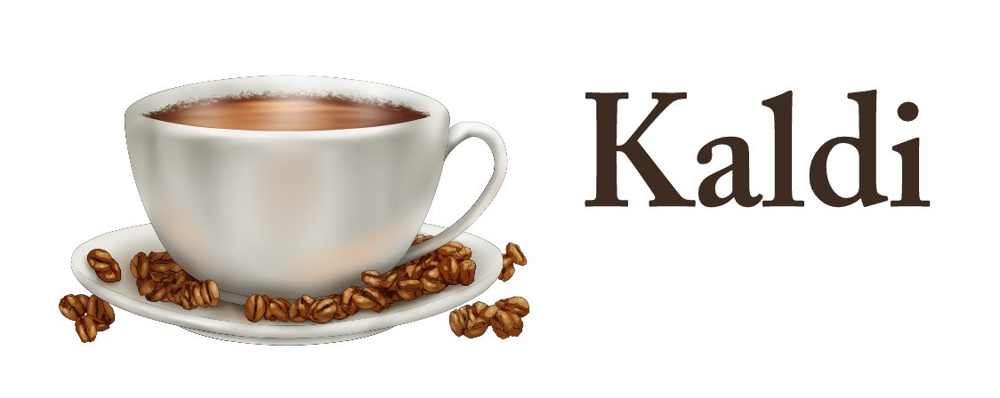

\page mod_kaldi Kaldi

# Kaldi

Kaldi is the graphics abstraction layer (RHI/HAL) that Lotte is built on. It defines a
backend-agnostic, VM-like command vocabulary and the object-oriented facade that records
it. The rendering backends are separate shared libraries: [KaldiGL](../KaldiGL/README.md),
[KaldiGLES](../KaldiGLES/README.md), [KaldiVK](../KaldiVK/README.md),
[KaldiD3D11](../KaldiD3D11/README.md) and [KaldiD3D12](../KaldiD3D12/README.md).

**New here? Read [docs/graphics/KALDI_TUTORIAL.md](../docs/graphics/KALDI_TUTORIAL.md).** It walks through
the raw tagged-union API and the object-oriented facade side by side, with a complete
textured triangle, and explains the retirement, lifetime and threading contracts.

**Status: the contract and the recording facade are implemented; OpenGL, OpenGL ES and
Vulkan execute it.** The command vocabulary (98 opcodes), the HAL 1.0/1.1/1.2 contract, and
the header-only recording facade are usable today. `KaldiGL`, `KaldiGLES` and `KaldiVK`
implement `processCommandQueue()` (the GL family and Vulkan backends report HAL 1.2);
`KaldiD3D11` and `KaldiD3D12` still build stubs that export the C ABI but cannot execute
commands yet.

## Key files

| File | Contents |
|---|---|
| `KaldiOperation.hpp` | The command vocabulary: 98 `Opcode` values, their POD payload structs, and the `GfxOp` tagged union |
| `KldHal.hpp` | `HalVersion`/`KaldiHalVersion1_0`, `HalCapabilities`, `HalStatusCode`, `HalStatus` |
| `KldDevice.hpp` | The abstract backend submission interface `Device` |
| `KldCommandBuffer.hpp` | Header-only recording facade: `HandleStorage` (one id pool for every kind), `CommandDispatcher`, `OopFacade` proxies, `mergeCommandBuffers`, `DeferredDestroyQueue`; documented in [docs/graphics/KALDI_TUTORIAL.md](../docs/graphics/KALDI_TUTORIAL.md) |
| `KldVertexFormat.hpp` | `PrimitiveType`, `AttributeDescriptor`, `VertexDescriptor` |
| `KldNativeWindow.hpp` | `WindowSystem`, `NativeWindowHandles`, `nativeWindowHandlesFrom(SDL_SysWMinfo)` - the backend-neutral window-handle extraction shared by EGL/GLX/WGL/D3D/Vulkan |
| `KldConfig.hpp` | Configuration contract: `ContextPurpose`, `DeviceConfig`, `ConfigField`, `ConfigReader`, `ConfigProvider`, and the field-reading helpers that clamp values |
| `KaldiLib.h` | C ABI shared with dynamically loaded backends (device creation, renderer name, version, last error) |

Kaldi's `.pro` still produces a shared library, but there is no public linkable API;
consumers add `include(Kaldi/Kaldi.pri)` for include paths and do not link `-lKaldi`.

## Macro collisions with platform headers

Kaldi headers are included in the same translation unit as `<X11/Xlib.h>` by the GLX and
Vulkan backends, and Xlib is generous with short, attractive macro names. These
identifiers were therefore renamed, and the reason is recorded on each declaration:

| Was | Is | Because `<X11/X.h>`/`Xdefs.h` defines |
|---|---|---|
| `CompareOp::Always` | `CompareOp::AlwaysPass` | `#define Always 2` |
| `CullMode::None` | `CullMode::NoCulling` | `#define None 0L` |
| `HalStatusCode::Success` | `HalStatusCode::Succeeded` | `#define Success 0` |
| `ConfigValueType::Bool/Integer/Float/String` | `...::BoolValue/IntegerValue/FloatValue/StringValue` | `typedef int Bool;` (and similar typedefs elsewhere) |

When adding enumerators or field names to Kaldi, keep them long enough not to collide with
`None`, `Always`, `Success`, `Bool`, `True`, `False`, `Status`, `Window` or `Display`.

## Window handles and configuration

`KldNativeWindow.hpp` is the one place that knows how to turn `SDL_SysWMinfo` into native
handles; every backend consumes the result instead of repeating the SDL switch.
`KldConfig.hpp` is the configuration contract: a backend describes the settings it exposes
(`ConfigField` with key, type, range, default, choices, help) and applies them from a
`ConfigReader`. The GL provider lives in `KaldiGLCommon/GlContextConfig.hpp`, and the
`.ini` persistence (`Euph::Conf::Configuration`) lives in
`Lotte/Conf/LteBackendConfig.hpp`.

## Current command model

`KaldiOperation.hpp` is the canonical example for the new VM-like API shape. It uses a single `HandleId` namespace for backend-preallocated resources, an `Opcode` enum to identify commands, and small POD payload structs inside `GfxOp`.

`KldHal.hpp` defines the public HAL contract: `HalVersion`, `HalCapabilities`, `HalStatusCode`, and `HalStatus`. Backend-specific probing stays inside backend initialization. Higher layers consume the resulting portable capabilities and status codes instead of depending on backend-specific extension or feature details.

Capability probing lives next to each backend's context layer: `KaldiGLCommon/GlCapabilities.*` (shared by OpenGL and OpenGL ES), `KaldiVK/VkCapabilities.*`, and the win32-only `D3D11Capabilities.*` / `D3D12Capabilities.*`. A probe fills `HalCapabilities` from the queries the API actually offers, gates optional features on the *actual* context/device version and extensions rather than on what was requested, and reports `Kld::halCapabilitiesNone()` when no device exists (a detached backend, or a probe running without a current context). `GL::Device`, `GLES::Device` and `Vk::Device` run their probe during construction and return the stored snapshot from `capabilities()`; the Direct3D probes are ready for the same wiring once those device classes own their API device.

`KldDispatch.hpp` is the backend-side half of the submission boundary. It provides the `KLD_OPCODE_LIST` X-macro (the single source of truth for opcode names and `Kld::kOpcodeCount`), `Kld::opcodeName()` / `Kld::isKnownOpcode()` diagnostics, and the structure-shifting `KLD_DISPATCH_*` macros that turn one flat command span into a tag dispatch. On GCC and Clang the macros expand to direct threading (computed goto with one dispatch jump per handler); on MSVC and other compilers they expand to an equivalent `switch`, so a backend writes its handlers once. The layer is header-only, contains no backend API calls, and therefore serves every backend - the dispatch table lives entirely inside each backend's own `processCommandQueue` implementation. See @ref KldDispatch.hpp for the usage contract and the handler-termination rules.

Command payloads may reference externally owned data by pointer. As with the existing texture upload commands, callers must keep pointed-to data alive until the backend has processed the command queue. That rule covers upload/readback memory, shader words, vertex descriptors, framebuffer attachment arrays, pipeline binding layouts, swapchain descriptors/image bindings/native surface pointers, render-pass descriptors/attachment arrays, debug strings, optional pipeline names, callbacks, and callback `userData`.

`processCommandQueue()` is implemented for the GL family and for Vulkan. `KaldiGLCommon/GlCommandExecutor.*` is a complete OpenGL 4.3 / OpenGL ES 3.2 executor shared by both backends (resource registries, the `KLD_DISPATCH_*` structure, pipeline variants from SPIR-V, every draw/state/transfer/query handler, the default frame path and explicit swapchain objects as a validated view of the drawable). Its destroy commands delete GL names immediately, which satisfies the retirement contract because the GL driver keeps an object alive until the last referencing command has executed. `KaldiVK/VkCommandExecutor.*` is a frames-in-flight executor (three slots, fence-driven retirement, a per-slot descriptor ring and staging ring, allocation through VulkanMemoryAllocator) that implements the whole opcode set: device-local static buffers with host-visible ones for per-frame data, 1D/2D/3D/array/cube textures, 2D/multisampled/depth images, samplers, framebuffers with a render pass each, SPIR-V graphics and compute pipelines with one descriptor set per binding kind, every draw/dispatch/copy/query form, debug labels through `VK_EXT_debug_utils`, explicit swapchain objects, and the default swapchain path. Its remaining `UnsupportedBaseline` answers name Vulkan 1.0 limitations precisely (base-instance draws, vertex instance divisors, per-sampler LOD bias, depth/stencil and compressed readback, explicit swapchains with a depth attachment). The Direct3D 11 and 12 `Device` classes own their `Context` objects and probe real capabilities, but still answer `processCommandQueue()` with `UnsupportedBaseline`; their `.cpp` files document the intended registry/pipeline/retirement design in place.

Readback commands use POD callbacks plus `void* userData`, matching the buffer mapping command style. Backend-provided callback data is valid only for the duration of the callback; callers must copy anything they need after the callback returns. The callback pointer and `userData` must remain valid until the backend has processed the command queue.

Pipeline shader binaries are SPIR-V word arrays. `ShaderBinaryDescriptor` stores the shader stage, a `const uint32_t*` pointer, and a word count; the pointed-to words must outlive command processing. `VertexDescriptor` remains the vertex input contract. `PipelineBindingLayout` can optionally describe sampled texture, sampler, uniform buffer, storage buffer, and storage image slots when a backend needs explicit shader resource layout metadata. There are still no built-in pipelines; engines provide their own shader binaries, vertex input, and binding layout declarations.

Compressed texture commands treat payload bytes as opaque backend-facing block-compressed data. The command includes explicit block width, block height, and bytes-per-block metadata so DDS-style mip payloads can be passed through without CPU decompression.

Texture creation from `const Euph::Media::Image::DecodeTarget*` treats frames as mip levels: frame 0 is mip 0, frame 1 is mip 1, and so on. If `generateMipmaps` is true, the backend uses frame 0 and generates the rest.

Frame lifecycle is recorded as ordinary commands: the `oop_detail::beginFrame(dispatcher, framebuffer)` helper pushes `Opcode::BeginFrame` (defaulting to `DefaultFramebuffer`), and `oop_detail::endFrame`/`oop_detail::present` push the matching end/present commands. The device remains the submission boundary through `Device::processCommandQueue(std::span<const GfxOp>)`, which returns `HalStatus`; `CommandDispatcher::submit(Device&)` is the convenience path that hands the current read buffer to a backend. The earlier `ResourceFactory` design and the misspelled `processCommandQeue` wrapper no longer exist in the tree.

## Kaldi HAL 1.0 contract

Kaldi HAL 1.0 is identified by `KaldiHalVersion1_0`. A conforming backend reports a `HalCapabilities` snapshot after its private initialization/probing step. The baseline is the command vocabulary already present in `KaldiOperation.hpp`: buffers, sampled textures, images, framebuffers, samplers, graphics and compute pipelines, render state, synchronization, transfer/readback, cube maps, texture arrays, multisample resolves, storage resources, indirect work, queries, debug labels, and instanced draws. Capability limits tell higher layers how much of that vocabulary can be used portably on a specific backend instance.

Occlusion queries use the common denominator shared by OpenGL 4.x, Direct3D 11, Vulkan, Direct3D 12, and WebGPU: portable callers may depend only on binary zero/nonzero visibility. A readback value of `0` means no samples passed the active per-fragment tests; any nonzero value means at least one sample passed. Backends that naturally produce exact sample counts may return those counts through the existing `uint64_t` query result path, but portable engine code must treat `QueryType::Occlusion` as binary unless a future precise query type or explicit capability says otherwise.

Backend failures are reported through `HalStatus`. Initialization can fail because the baseline is unsupported. Submission can report invalid commands, invalid handles, invalid resource states, allocation failure, swapchain loss, shader creation failure, pipeline creation failure, or a generic backend error. Optional status messages are backend-owned text; callers copy the message if they need it later.

The default framebuffer is backend-owned and addressed as `DefaultFramebuffer`. Version 1.0 keeps swapchain creation, resize, default color/depth formats, and present mode inside the backend. `BeginFrame`, `EndFrame`, and `Present` report failures through submission status, with `SwapchainLost` covering resize/recreation cases until a future explicit swapchain API exists. Default framebuffer images are not directly referenced as ordinary `Image` handles in v1.0.

Destroy commands are logical retirement requests. Backends must delay physical deletion until all previously submitted work that can reference the resource has completed. RAII proxy destruction records the destroy command; it does not imply immediate backend deletion. This is especially important when multiple frames are in flight.

`CommandBuffer` remains the single-threaded v1.0 recording primitive. Append order is execution order. Per-thread merge helpers, shared handle allocators, deferred destruction queues, and opt-in thread-safe facades remain higher-level or future additions.

## Kaldi HAL 1.1 contract additions

Explicit swapchains are optional caller-visible presentation objects addressed by `HandleId`, with `DefaultSwapchain` reserved as `0` for the backend-owned default target. `SwapchainDescriptor` carries an opaque backend-facing native surface pointer, dimensions, color/depth formats, present mode, image count, and optional `SwapchainImageBinding` entries that associate swapchain image indices with predeclared image/framebuffer handles. `AcquireSwapchainImage` reports `SwapchainStatus` plus the active image through a POD callback, and `PresentSwapchain` presents an image by index. Existing `BeginFrame`, `EndFrame`, and `Present` remain the simple default-framebuffer path. Swapchain loss is still reported through `HalStatusCode::SwapchainLost`.

Backends that own their presentable images report a *usable* framebuffer handle instead of the caller's: IDs from `BackendHandleBase` (`0x80000000`) upwards belong to the backend, so an acquire callback can hand back something the caller may bind but must not destroy. `HalCapabilities::supportsExplicitSwapchains` says whether a backend honours the whole group, and a 1.1 backend reports `KaldiHalVersion1_1`.

Render-pass metadata is available through `RenderPassDescriptor`, `RenderPassColorAttachment`, and `RenderPassDepthStencilAttachment`. `BeginRenderPass` implicitly establishes its framebuffer for following draw commands and describes each attachment's load, clear, store, or don't-care policy. `EndRenderPass` closes that scope. The older `BindFramebuffer` plus explicit clear commands remain valid for immediate-style backends and simple command streams.

Parallel recording support is deliberately conservative. A shared `HandleAllocator` gives worker command buffers disjoint handle IDs, but it does not make a single `CommandBuffer` thread-safe. `CommandBuffer::append` and `mergeCommandBuffers` concatenate already-recorded command spans in caller-specified order, which is the execution order. Cross-thread resource ownership uses `release()` plus a coordinator-owned `DeferredDestroyQueue`; flushing that queue records typed destroy commands into the coordinator command buffer.

## Kaldi HAL 1.2 contract additions

`HalCapabilities::clipSpaceYAxis` names the direction of the positive y axis in normalized device coordinates, and `KaldiHalVersion1_2` tags a backend that reports it. `OpSetViewport` already uses the OpenGL convention for the viewport *rectangle* (origin bottom-left) and every backend translates that to its own window-space origin; the clip-space **direction** is a separate question that the APIs answer differently:

| API | NDC `y = +1` is | `clipSpaceYAxis` |
|---|---|---|
| OpenGL / OpenGL ES | the top of the framebuffer | `ClipSpaceYAxis::Up` |
| Direct3D 11 / 12 | the top of the framebuffer | `ClipSpaceYAxis::Up` |
| Vulkan | the bottom of the framebuffer | `ClipSpaceYAxis::Down` |

Any renderer that builds clip-space positions itself - a 2D UI whose vertices are pixels, or a 3D projection matrix - must consult this value. Assuming one convention makes the same vertex data render vertically flipped on the other backend; that is exactly what happened to Lotte's first cursor draw on Vulkan while the OpenGL path was already correct. The field is zero-initialised to `Up`, so a consumer that never sees a probed device keeps the pre-1.2 assumption.

## Facade model

`KldCommandBuffer.hpp` provides a thin client-side object-oriented facade over the VM command interface. `Kld::CommandBuffer` owns command storage with `std::pmr::vector<GfxOp>`, allocates local monotonic `HandleId` values starting at `1`, and submits spans to `Kld::Device`. Resource proxy classes are move-only RAII wrappers; when an owning wrapper is destroyed, it appends the matching destroy operation to its command buffer.

`Kld::CommandBuffer` is not internally synchronized. Record from one thread at a time, use separate command buffers per worker thread, or provide external synchronization. Making a shared command buffer thread-safe requires protecting both ID allocation and command storage, not just making the ID counter atomic.

## Thread-safe command recording ruminations

The current `CommandBuffer` is deliberately single-threaded. That is a valid long-term option, not merely an omission: command recording is cheap, command ordering is explicit, the facade stays header-only and small, and users who care about parallel recording can already give each worker its own command buffer. The downside is that the RAII proxies are only as safe as their owning command buffer. Destroying a `Texture`, `Buffer`, `Pipeline`, or other owning proxy appends a destroy command, so moving or destroying proxies on another thread is also a recording operation. With the current design, "do not share a command buffer across threads" must include everything owned by it.

A coarse-locking `ThreadSafeCommandBuffer` would be the most conservative future facade. It could wrap `nextId`, `commandStorage`, `push`, `allocateId`, `clear`, `span`, `submit`, and every RAII-destruction path behind one mutex. This is easy to reason about and preserves a single total command order matching lock acquisition order. It would also make proxy destruction from different threads mechanically safe. The cost is that every tiny inline helper becomes a lock/unlock pair, `span()` cannot safely expose storage while another thread records, and `submit()` or `clear()` would need clear rules: either hold the lock while the backend consumes the span, or snapshot/copy the queue first. Holding the lock through backend processing is simple but may block destructors and producers for too long; copying preserves responsiveness but undermines the current externally owned, no-extra-ownership model.

Making only `nextId` atomic is insufficient. It prevents duplicate handles, but `std::pmr::vector<GfxOp>` mutation remains unsafe, `clear()` can race with `push()`, and RAII destructors can append destroy commands while another thread is recording or submitting. An atomic-ID plus locked-storage design is possible, but once storage is locked, the atomic counter buys little except narrower critical sections around resource creation. It also does not solve command ordering: two threads can allocate IDs in one order and append creation commands in another. That may be acceptable, but it should be documented as "append order is execution order; ID order is not semantic."

Per-thread command buffers with an explicit merge step probably fit the VM model best. Each worker records into its own unsynchronized `CommandBuffer`, using either disjoint handle ranges or a shared thread-safe `HandleAllocator`. At the frame boundary, a coordinator concatenates command spans in an explicit order and submits one combined queue or multiple ordered queues. This keeps normal recording fast, avoids locking around every command, and makes ordering a caller-visible decision. The price is that resource ownership becomes less local: an RAII proxy cannot safely append its destroy command into a worker buffer that has already been merged, cleared, or destroyed. This model likely wants non-owning lightweight handles for cross-thread use, plus an explicit retirement/deferred-destroy queue owned by the coordinator.

Another possible design is a multi-producer command sink: workers reserve slots in append-only chunks, write POD `GfxOp`s into those chunks, and a submitter drains completed chunks. This can reduce lock contention while still sharing one logical command stream. It is also much more complex. The sink needs stable memory for chunks, a way to publish fully written commands, a deterministic ordering rule, and careful handling of pointer payload lifetimes. Because many commands reference externally owned data, "command recorded" is not enough; the pointed-to bytes, shader words, names, descriptors, and callbacks must outlive backend processing.

An actor/owner-thread model is the safest high-level ownership story. All owning proxies would be destroyed on the command-buffer owner thread, or their destructors would enqueue lightweight destroy requests to that owner. This avoids shared mutation of command storage and makes lifetime rules crisp. It is less convenient for users who expect C++ RAII objects to be freely movable between threads, and it introduces a queue or mailbox anyway. It also means destruction is no longer simply "append now"; it becomes "request destruction, owner records later."

Recommended future direction: keep `CommandBuffer` unsynchronized and documented as the zero-overhead primitive; add a separate parallel-recording layer if real examples need it. The likely first step should be a shared `HandleAllocator` plus per-thread command buffers and an explicit merge/submission helper. If RAII proxies must cross threads, add a coordinator-owned deferred destruction queue rather than making every proxy destructor lock a shared command vector. A coarse-locking wrapper is still useful as a debug or convenience facade, but it should be opt-in so the default API keeps its current predictable cost model.

## Modern graphics HAL foundation ruminations

Kaldi is not a game engine and should not grow engine-level concepts such as worlds, entities, visibility systems, materials, asset databases, animation graphs, physics, networking, editor tooling, or gameplay-facing scene ownership. Its job is lower-level: provide a small, stable command vocabulary that can abstract backend APIs such as OpenGL 4.x, Direct3D 11, Vulkan, Direct3D 12, and future APIs with different execution and synchronization models.

The current command vocabulary is already enough to describe a useful amount of GPU work: static and dynamic buffers, textures, cube maps, texture arrays, samplers, graphics pipelines, render targets, clears, draws, indexed draws, instanced draws, explicit updates, transfer/readback work, multisampled resolves, storage buffers/images, frame lifecycle, render state, barriers, compute, indirect work, queries, and debug labels. Query portability should favor the shared subset first: for example, occlusion queries are visibility tests with zero/nonzero results, not guaranteed precise sample counters. That is enough for a higher layer to start building renderers in the spirit of Quake 3, Unreal Engine 1998, or many 2000s-era engines. Those engines' higher-level systems should live above Kaldi and compile their decisions down into existing buffer, texture, pipeline, bind, and draw commands.

The gap is not "more engine." The gap is contract clarity. A low-level abstraction must tell callers what the device can do, what limits and formats are supported, how command submission and resource lifetime work, how swapchains/default framebuffers are represented, how binding layouts map onto very different backend APIs, and how errors are reported. Without those contracts, the command stream can express work, but a renderer cannot confidently plan portable work.

OpenGL 4.x and Direct3D 11 can hide many synchronization and lifetime details behind driver-managed state. Vulkan and Direct3D 12 make those details explicit. Kaldi should avoid becoming a direct clone of either family, but it needs enough vocabulary that both styles can be implemented faithfully: explicit submission boundaries, predictable resource state transitions, clear ownership of command payload memory, and a defined policy for work that a backend cannot support directly.

Compatibility with Quake 3-like or early-Unreal-like renderers is still a useful pressure test, but only as a workload shape: lots of static geometry, lightmaps, dynamic meshes, render-state sorting, texture streaming, visibility-driven batches, and tool readback. Kaldi should not implement those systems. It should make sure a layer above can implement them without relying on backend-specific escape hatches for basic graphics work.

The strongest next move is probably not to add every modern GPU concept. It is to define the contracts that make the existing commands dependable across old immediate-style APIs, modern explicit APIs, and future backends: capabilities, submission lifetime, default framebuffer ownership, binding layout conventions, synchronization semantics, and backend error reporting. After that, add missing resource kinds only when a concrete backend or renderer-shaped smoke test exposes a real abstraction gap.

## Completed migration ledger

- [x] Complete the missing framebuffer/render-target vocabulary in the old model.
- [x] Add Kaldi image/framebuffer/bind/clear/present commands.
- [x] Translate old pipeline resource binding and draw calls into Kaldi VM commands.
- [x] Translate mesh and uniform-buffer mutation into explicit buffer resize/upload/update commands.
- [x] Support legacy mesh and uniform-buffer mutation via memory-mapping commands that temporarily map the data into memory, execute a function pointer callback, and avoid `std::function` so ops stay PODs.
- [x] Translate writable texture resize/blit/update into explicit texture/image mutation commands.
- [x] Define the final `ResourceFactory::beginFrame` / `endFrame` mapping onto bind, submit, and present command queues.
- [x] Decide whether shader binaries need a richer typed stage model than the current externally owned descriptors. Shaders are SPIR-V `const uint32_t*` plus `size_t` word-count pairs with explicit shader stages.
- [x] Brainstorm other commands that one would expect from a modern-ish 3D API abstraction / HAL.
- [x] Implement render state commands from the Future HAL Command Backlog.
- [x] Implement synchronization and resource transition commands from the Future HAL Command Backlog.
- [x] Implement compute, indirect work, query, and debug commands from the Future HAL Command Backlog.
- [x] Create a thin, header-only, zero-overhead / minimal-overhead (via use of inline functions) object-oriented facade around the ID, command buffer, client-server, VM-like interface to reduce boilerplate, consisting of classes that provide object-oriented, RAII-oriented (Resource acquisition is initialization) wrappers around this command buffer interface. This will require a class that actually owns the command buffer via a `std::pmr::vector<GfxOp>` (implementations of `Kld::Device` will NOT own the data - we are decoupling ownership of the data from operations on the data!) These object-oriented proxies shall only contain the dumb IDs of their respective resources (e.g. TextureId) and a pointer to the class that owns the `std::pmr::vector<GfxOp>`.
- [x] Document everything Doxygen-style.
- [x] Support compressed texture creation/update with explicit block metadata.
- [x] Support creating 2D textures directly from `const Euph::Media::Image::DecodeTarget*` pointers, interpreting frames as mip levels.
- [x] Add command-buffer facade helpers for compressed textures and `DecodeTarget*` texture creation.
- [x] Explore and document future thread-safe command recording options.
- [x] Add low-level transfer and readback commands with POD callback payloads.
- [x] Add cube maps, 2D texture arrays, multisampled images, resolve commands, storage bindings, and instanced draws as HAL primitives.
- [x] Add command-buffer facade helpers for transfer/readback and advanced resource commands.
- [x] Define Kaldi HAL versioning and backend-reported v1.0 capability limits.
- [x] Define portable backend status reporting for initialization, unsupported baselines, invalid commands/handles/states, allocation failures, swapchain loss, and shader/pipeline creation failures.
- [x] Specify command payload, callback/user-data, shader word, descriptor, debug string, upload, and readback lifetime rules.
- [x] Define the v1.0 default framebuffer/swapchain contract around backend-owned `DefaultFramebuffer` and status-returning frame/present submission.
- [x] Define resource retirement as backend-deferred physical deletion after logical destroy commands.
- [x] Keep `CommandBuffer` single-threaded for v1.0 and document future parallel-recording directions separately.
- [x] Add explicit optional shader resource binding layout metadata while keeping engine-owned shaders and `VertexDescriptor` as the vertex input contract.
- [x] Decide that the current bind/clear/draw model is sufficient for v1.0; render-pass/load-store metadata can wait for a concrete backend need.
- [x] Keep facade ergonomics in parity with the raw command vocabulary for the current opcode set.
- [x] Add explicit swapchain objects, present modes, image/framebuffer bindings, acquire callbacks, and present commands.
- [x] Add render-pass/load-store metadata while keeping the older bind/clear/draw model valid.
- [x] Add conservative parallel recording helpers: shared handle allocation, ordered merge/append, and coordinator-owned deferred destruction.
- [x] Add the backend-side dispatch layer (`KldDispatch.hpp`): `KLD_OPCODE_LIST`, opcode name/validity helpers, and the structure-shifting computed-goto / `switch` macros shared by every backend.
- [x] Probe `HalCapabilities` in the GL, GLES, Vulkan, D3D11 and D3D12 backends, with `halCapabilitiesNone()` as the portable "not probed yet" fallback.
- [x] Add the GL execution-policy configuration (`GlDeviceConfig`): a `Kld::ConfigProvider` that composes the context fields with UT-inspired keys (`bGlDebugLabels`, `bGlForceNearestFiltering`, `bGlForceTrilinear`, `fGlTextureLodBias`, `fGlMaxAnisotropy`, `iGlMaxTextureSize`), plus unit tests for the defaults, clamping and description.
- [x] Implement `processCommandQueue()` for OpenGL 4.3 and OpenGL ES 3.2 (`KaldiGLCommon/GlCommandExecutor.*`): resource registries, deferred-retirement semantics via GL's own object lifetime, SPIR-V pipelines with a GL 4.3 command executor (all draws, state, barriers, transfers, queries, debug labels, render passes and the default frame path).
- [x] Validate the GL and GLES executors with real offscreen draw + per-pixel readback smoke tests (EGL desktop GL and GLES, NVIDIA), including the invalid-handle error path.
- [x] Implement the Vulkan command executor (`KaldiVK/VkCommandExecutor.*` and the `VkExecutor*` translation units): synchronous submit-and-wait, every resource kind, SPIR-V graphics/compute pipelines, all draws/dispatches/copies/queries and the default swapchain path, with documented `UnsupportedBaseline` answers for the remaining Vulkan 1.0 limitations.
- [x] Replace the Vulkan backend's synchronous submit-and-wait with frames in flight and a fence-driven retirement queue.
- [ ] Give the Direct3D 11/12 backends their own command executors.
- [x] Implement explicit swapchain objects in the Vulkan backend (HAL 1.1) and as a validated drawable view in the GL family.
- [x] Validate the swapchain contract against real OpenGL, OpenGL ES and Vulkan devices (create, acquire, draw, resize, present, destroy; validation-layer clean on NVIDIA).
- [x] Validate the Vulkan device/buffer/frame path on NVIDIA and lavapipe with a live smoke test (buffer map + BeginFrame/EndFrame/Present).
- [x] Give the Direct3D 11/12 device classes provisional `capabilities()`/`processCommandQueue()` implementations that report `UnsupportedBaseline`, and document the intended porting structure in place.

## Future graphics HAL TODOs

- [ ] Implement the remaining backend work: the Direct3D 11/12 backends need their command translation (registries, pipelines, SPIR-V -> HLSL, retirement) on top of the device ownership they already have. GL/GLES, Vulkan and the swapchain contract are complete; Vulkan's remaining work is device-local buffer memory and depth/stencil readback.
- [ ] Validate the swapchain contract against Direct3D 11 and Direct3D 12 backends (OpenGL, OpenGL ES and Vulkan are validated).
- [ ] Validate render-pass/load-store metadata against tile-based and explicit APIs, then add subpasses or dependency metadata only if real backend work needs it.
- [ ] Build a renderer-shaped parallel recording example to pressure-test merge ordering, shared allocation, and deferred destruction ergonomics.
- [ ] Add RAII facade proxies for swapchains and render passes. `oop_detail` currently provides
      `Buffer`, `Texture`, `Image`, `Sampler`, `Framebuffer`, `Pipeline`, `ComputePipeline`,
      `Fence` and `QueryPool` proxies; swapchain/render-pass commands exist only as raw opcodes
      and `oop_detail` static helpers.
- [ ] Add tests for `KldCommandBuffer` (handle allocation, RAII destruction, merge order,
      deferred destruction). `Sandbox` currently has no direct Kaldi device coverage; its geometry-batch scenarios only record into a `CommandBuffer`.
- [ ] Define portable fallback values for `HalCapabilities` so backends that cannot probe a
      limit do not report uninitialized data.
