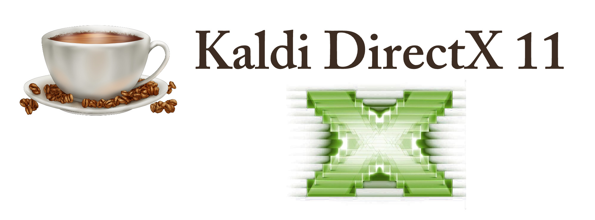

\page mod_kaldid3d11 KaldiD3D11

# KaldiD3D11

Direct3D 11 backend for the Kaldi graphics HAL (see [Kaldi](../Kaldi/README.md)).

**Status: device ownership complete, no executor.** The C ABI is exported and the
shared translation helpers compile. `D3D11::Device` now owns a `D3D11::Context`
(the `ID3D11Device`, its immediate context and the swap chain) and probes real
capabilities from it through `D3D11::probeCapabilities()`. On non-Windows hosts
the context cannot exist, so the windowed constructor throws and the device stays
detached (`hasContext() == false`, no capabilities); the C ABI reports the reason
through `kld_get_last_error_message()`.

`processCommandQueue()` remains a **documented stub** that returns
`HalStatusCode::UnsupportedBaseline`, because no command executor exists yet. The
intended executor structure is spelled out in `KaldiD3D11Device.cpp`. The Direct3D
translation units (`D3D11Context.cpp`, `D3D11Capabilities.cpp`, `D3D11Util.cpp`)
are gated behind `win32` in the `.pro`, and there is no Windows host to validate
them - the code is written against the documented API but untested.

Requires [SPIRV-Cross](https://github.com/khronosgroup/spirv-cross) to be built with `cmake .. -DCMAKE_POSITION_INDEPENDENT_CODE=ON -DSPIRV_CROSS_SHARED=ON`.
Otherwise, the compiler will complain about linking static SPIRV-Cross
libraries (`libspirv-cross-core.a`) into a shared library (`.so`) or a
Position-Independent Executable (PIE), when the static libraries were
compiled without Position-Independent Code (`-fPIC`)

## Build

| Item | Value |
|---|---|
| qmake target | `KaldiD3D11` (`TEMPLATE = lib`, shared, C++20, no Qt) |
| Export macro | `MH_KALDI_IMPL_EXPORT` while building, `MH_KALDI_IMPL_API` for consumers |
| Files | `KaldiD3D11Device.*`, `KldImplLib.h`, `D3D11Util.*`, `D3D11Capabilities.*` (win32 only), plus the shared sources from `KaldiD3DCommon` |
| Depends on | Kaldi headers via `include(../Kaldi.pri)`; links `spirv-cross-core` and `spirv-cross-hlsl` for SPIR-V to HLSL cross-compilation (a backend concern, not a Kaldi or Euphemy dependency) |
| Platform | Windows (Direct3D 11); the portable `.so` stub target is still generated on other hosts |

## What exists today

| File | State |
|---|---|
| `KldImplLib.h` | Declares the backend C ABI: `kld_create_rendering_device`, `kld_destroy_rendering_device`, `kld_get_renderer_name`, `kld_get_version`, `kld_get_last_error_message` |
| `KaldiD3D11Device.hpp` / `.cpp` | `D3D11::Device : Kld::Device`; owns a `D3D11::Context` (Windows only, forward-declared in the header), probes `capabilities()` from the owned device, reports `UnsupportedBaseline` from `processCommandQueue()` until an executor exists, and implements the C ABI with a thread-local error message |
| `KaldiD3D11Device.cpp` | Stub exports: create returns `nullptr`, destroy is a no-op, renderer name is `"Direct3D11 Renderer"`, version is `"0.0.1"`, last error is `nullptr` |
| `D3D11Context.hpp` / `.cpp` | `D3D11::Context`: `D3D11CreateDeviceAndSwapChain`, the RTV/DSV pair, `present()` and `resize()`; **Windows only, unverifiable here** |
| `D3D11Util.hpp` / `D3D11Util.cpp` | `Kld::VertexDescriptor` -> owning `D3D11_INPUT_ELEMENT_DESC` layout, `Kld::BufferMapAccess` -> `D3D11_MAP`, `DecodeTarget` -> `D3D11_SUBRESOURCE_DATA`; **Windows only** |
| `D3D11Capabilities.hpp` / `.cpp` | `D3D11::probeCapabilities(ID3D11Device*)`: `D3D11_REQ_*` extents, MSAA sample-count query, feature-level 11_0 gates for compute/indirect/UAV, BC1/BC3 format support; **Windows only, unverifiable here** |
| `../KaldiD3DCommon/D3DUtil.*` | Euphemy `Format` and `Kld::PrimitiveType` -> `DXGI_FORMAT`, depth/compression queries, alignment helpers; Windows only |
| `../KaldiD3DCommon/D3DSPirvShader.*` | SPIR-V (`Kld::ShaderBinaryDescriptor`) -> HLSL source (Shader Model 5.0 default); portable, no D3D headers needed |

## Header provenance and validity

The Direct3D 11 backend still takes its SDK headers from `extern/DXSDK`, which is a
mirror of several DirectX SDK releases assembled by the
[apitrace](https://github.com/apitrace/dxsdk) project rather than an official Microsoft
distribution. See the "Header provenance" section of
[KaldiD3DCommon](../KaldiD3DCommon/README.md) for what that means for ABI safety and
redistribution. In short: fine as a **compilation fallback**, not a substitute for the
Windows SDK, and not something to ship in a binary release.

## TODO

- [x] Add `D3D11::probeCapabilities(ID3D11Device*)` reporting `KaldiHalVersion1_0` with probed limits.
- [x] Give the device ownership of a `D3D11::Context` and wire the probe into `Device::capabilities()`; the C ABI now creates and destroys real devices.
- [ ] Implement `CommandExecutor` (handle registries, create/bind/draw translation, SPIR-V -> HLSL, deferred destruction) and replace the `UnsupportedBaseline` stub in `Device::processCommandQueue()`.
- [ ] Create the `ID3D11Device`/`ID3D11DeviceContext` and an `IDXGISwapChain` from the `SDL_SysWMinfo` HWND.
- [ ] Feed `D3D::spirvToHlsl()` output through `D3DCompile` (or `dxc`) and create the shader objects.
- [ ] Implement descriptors, render targets, the default framebuffer/swapchain path and explicit swapchains.
- [ ] Implement deferred resource retirement for destroy commands.
- [ ] Return real status/error strings instead of `nullptr`.
- [ ] Get the backend to compile against a real Windows SDK on a Windows host.
- [ ] Add a smoke test that creates a device, uploads a texture and clears the default framebuffer.
