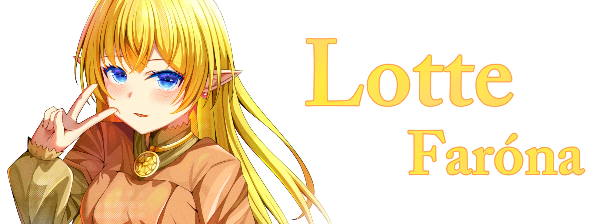

\page mod_lotte Lotte

# Lotte



Lotte is the higher-level graphics and GUI library of MhLib. It sits on top of Kaldi
(the graphics HAL) and Euphemy (assets, images, text-adjacent I/O), and is where
renderer-facing integration belongs so that Euphemy can stay independent of Kaldi.

**Status: partial.** Lotte owns the Kaldi bridge types, the CPU-to-GPU asset upload
scheduler, the FontPacker-compatible font/vector-image formats, the rich-text
pipeline (MML parsing, text layout, glyph quads), the mesh/GUI geometry batches, a
run-time-loaded Kaldi rendering context with a resource factory, a dirty-rectangle
writable texture and a working GUI renderer with anchored (2D and 3D) cursors.
The GUI base hierarchy (render tree, widget state machine, textured widget, root
node) and an abstract theme contract now exist; concrete controls, layout and
input routing are still on the TODO list.

## Build and consumption

| Item | Value |
|---|---|
| qmake target | `Lotte` (`TEMPLATE = lib`, `CONFIG += shared c++2a`, no Qt) |
| Export macro | `MH_LOTTE_EXPORT` while building, `MH_LOTTE_API` for consumers |
| Consumer hook | `include(Lotte/Lotte.pri)` adds the include path and links Lotte/Euphemy/Elvavena |
| Dependencies | Elvavena, Euphemy, Kaldi headers, GLM, utfcpp (header-only, `#include <utf8cpp/utf8.h>`), glslang + glslang-default-resource-limits + SPIRV (shader compilation) |

Compiled units: `Asset/LteGpuAssetStreamer.cpp`, `Conf/LteBackendConfig.cpp`,
`GFX/LteKaldiContext.cpp`, `GFX/LtePipeline.cpp`, `GFX/LteResourceFactory.cpp`,
`GFX/LteWriteableTexture2D.cpp`, `Gui/LteCursor.cpp`, `Gui/LteGuiRenderable.cpp`,
`Gui/LteGuiRootNode.cpp`, `Gui/LteKaldiGuiRenderer.cpp`,
`Gui/LteTexturedWidget.cpp`, `Gui/LteWidget.cpp`, `Gui/LteThemeDefinition.cpp`,
`Procedural/LteGuiAtlas.cpp`, `Procedural/LteGuiMaterials.cpp`,
`Procedural/LteSurfaceCanvas.cpp` and the ten `Text/*.cpp` files. `Procedural/LteSdf.hpp`
and the remaining `Gui/` and `GFX/` headers are header-only (templates plus inline
recording helpers).

Kaldi is consumed header-only through `Kaldi.pri`. Do not add `-lKaldi` or `libKaldi`
to Lotte; use the top-level include path.

## Shader compilation

`GFX/LtePipeline.cpp` is the only place in the tree that compiles shaders, and it
uses the **HLSL front-end of glslang** (linked as `-lglslang -lSPIRV
-lglslang-default-resource-limits`). HLSL is the engine's authoring language; the
compiler always emits *Vulkan* SPIR-V 1.0 (`EShClientVulkan`,
`EShTargetVulkan_1_0`, `EShTargetSpv_1_0`) so a single blob serves every backend:
Vulkan consumes it as-is, while the GL/GLES and D3D11/D3D12 backends cross-compile
it with SPIRV-Cross.

**glslang's HLSL front-end is deprecated** (as of April 2026, removed at the next
major version; see [issue #4210](https://github.com/KhronosGroup/glslang/issues/4210)).
The intended replacement is [DXC](https://github.com/microsoft/DirectXShaderCompiler),
whose only notable flaw here is that it targets Shader Model 6.x while this engine
authors HLSL at Shader Model 4/5 level. The migration is **deferred indefinitely**;
[`docs/graphics/SHADERS.md`](../docs/graphics/SHADERS.md) records the reference `dxc` invocation,
what each flag does, and the acceptance gate for the switch.

## Implemented

| Header | Contents |
|---|---|
| `LotteLib.hpp` | `MH_LOTTE_API` export macro |
| `LteKld.hpp` | Lotte aliases over the Kaldi facade: `CommandBuffer`, `Buffer`, `Framebuffer`, `Fence`, `Image`, `Pipeline`, `ComputePipeline`, `QueryPool`, `Sampler`, `Texture`, plus `OpAllocator`/`HandleAllocator` |
| `Asset/LteGpuAssetStreamer.hpp` / `.cpp` | `GpuAssetStreamer` - bridges Euphemy's CPU `ResourceRegistry` to Kaldi command buffers. Queues buffer/texture uploads and evictions, accounts GPU bytes against a budget, supports priority/pinning/strong references, and records work into move-only `GpuCommandBatch` objects that keep payload memory alive until commit or fail |
| `Text/LteFontFace.hpp` | FontPacker-compatible `WODF` font-face format (versions 1-3): SDF/MSDF/MSDFA channel types, distance metrics, glyph metrics, kerning tables, v2+ distance ranges/encoding flags/midpoint, float advances (26.6 decoded on import), deterministic absolute-offset TOC, and both importer (`operator>>`) and exporter (`operator<<`) over `Elv::Io::DataStream` |
| `VectorGraphic/LteStoredVectorImage.hpp` | FontPacker-compatible `WODI` stored-vector-image format with mip levels, encoding flags and stream import/export |
| `Conf/LteBackendConfig.hpp` / `.cpp` | Bridge between `Kld::ConfigProvider` and `Euph::Conf::Configuration`: writes a backend's field defaults into an `.ini`, serializes/parses the text, loads/saves through `Elv::Io::System`, and applies the file back through a `Kld::ConfigReader` (which clamps every value) |
| `GFX/LtePipeline.hpp` / `.cpp` | `compileShaderProgram()` (glslang's HLSL front-end, see [`docs/graphics/SHADERS.md`](../docs/graphics/SHADERS.md); HLSL or GLSL input, always emits **Vulkan** SPIR-V 1.0 so one blob serves every backend, pluggable `ShaderIncludeResolver`), the owning `ShaderBinary` (SPIR-V words + stage, convertible to `Kld::ShaderBinaryDescriptor`) and `Pipeline` (owns stages + vertex attributes and exposes Kaldi views) |

### `GFX/` and `Gui/` - context, resources, cursor

| Header | Contents |
|---|---|
| `GFX/LteKaldiContext.hpp` / `.cpp` | `KaldiContext` - the promoted `Sandbox/KaldiContext`: `dlopen`s a Kaldi backend, creates its device, owns one `CommandBuffer` plus a `ResourceFactory`, and provides the `beginFrame()` (BeginFrame + clear) / `endFrame()` (EndFrame + Present + swap + submit) protocol |
| `GFX/LteResourceFactory.hpp` / `.cpp` | `ResourceFactory` - the one place Lotte allocates Kaldi handles through `Kld::oop_detail`: `createTexture2D` (raw pixels, `DecodeTarget`, or a shared `DecodeTarget` the factory retains), `createBuffer`, `createSampler`, `createPipeline`, `createImage2D`, `createFramebuffer`, plus `retain()`/`submit()` for the payload lifetime Kaldi requires. It also hands out `conventions()`, the backend's resolved clip-space/winding/depth conventions, so renderers never read capabilities themselves |
| `GFX/LteWriteableTexture2D.hpp` / `.cpp` | `WriteableTexture2D` - CPU RGBA8 surface mirrored by a Kaldi texture with a dirty rectangle: `setPixel`, `fill`, `blitRgba8` (atlas stamping), `resize`, and `recordUpdate()` which records one `UpdateTexture2D` per dirty row (one for a full-width rectangle) |
| `GFX/LteImageConvert.hpp` | Header-only Euphemy → GUI conversion: `Rgba8Image`, `toRgba8()` for the 8-bit `RGBA/BGRA/RGB/BGR/RG/R` layouts, and `isRgba8Convertible()` |
| `GFX/LteClipSpaceConventions.hpp` / `.cpp` | `ClipSpaceConventions` - the single place that knows how a backend interprets clip space, and the fix for the whole family of "everything is upside down on Vulkan" bugs: `pixelToClip()` (2D, top-left pixels), `projection()`/`perspective()`/`orthographic()` (3D, y-up `[0,1]` depth adapted per backend), `frontFace()` (winding follows a mirrored projection) and `halRect()` (top-left pixels → the HAL's bottom-left viewport/scissor rectangles). Renderers get it from `ResourceFactory::conventions()` |
| `Gui/LteKaldiGuiRenderer.hpp` / `.cpp` | The first concrete `GuiRenderer`: two runtime-compiled HLSL pipelines (coloured `ColouredGuiVertex`, textured `ColouredTexturedGuiVertex`), CPU pixel→clip-space transform via `ClipSpaceConventions` (so Vulkan's y-down clip space and OpenGL/Direct3D's y-up both render upright), `GuiGeometryBatch` per pipeline, texture-state runs and straight-alpha blending. `beginFrame()` resets the caches, `flush()` records uploads + draws |
| `Gui/LteCursor.hpp` / `.cpp` | `AlphaCoverage` (alpha mask) + `CursorMetadata` (anchor, crawl mode, threshold, explicit hotspot, scale, visibility) + `Cursor`. Nine anchors (four corners, four edge midpoints, center) and five crawl modes (`NoCrawl`, `Diagonal`, `Vertical`, `Horizontal`, `Radial`); a 2D image visual (with atlas UVs) or a 3D model visual with a model-space origin and `modelPlacement()` |

#### Backend conventions are not a caller concern

Kaldi reports `HalCapabilities::clipSpaceYAxis` (HAL 1.2) because Vulkan's clip space is y-down while OpenGL's and Direct3D's is y-up. Everything that follows from that difference - the 2D pixel transform, a 3D projection matrix, the front-face winding a mirrored projection reverses, and the top-left versus bottom-left origin of viewport/scissor rectangles - is resolved once, in `Gfx::ClipSpaceConventions`, and handed to renderers by `ResourceFactory::conventions()`:

| What you have | What you call | What you never think about |
|---|---|---|
| A GUI position in pixels | `space.pixelToClip(position, targetSize)` | Vulkan drawing it upside down |
| Camera parameters, or an existing y-up `[0, 1]` projection | `space.perspective(fovY, aspect, near, far)`, `space.orthographic(...)`, `space.projection(matrix)` | projection handedness |
| A front-face declaration for culled 3D geometry | `space.frontFace(Kld::FrontFace::CounterClockwise)` | winding after a mirror |
| A sub-rectangle coming from a layout (a 3D view inside a 2D frame) | `space.halRect({x, y, width, height}, targetHeight)` | the HAL measuring rectangles from the bottom |

The canonical space is fixed and documented in the header: **2D** is top-left pixels with `+y` down and `z = 0`; **3D** is right-handed with `+y` up and depth in `[0, 1]` (the `_ZO` convention, which Vulkan wants directly and the GL backend rewrites in the shader). A game therefore never mentions a backend, a renderer never reads capabilities, and a `[-1, 1]`-depth projection is the only way to break it - which is why the builders exist instead of a bare matrix multiply. `ResourceFactory::setDevice()` refreshes the conventions when the backend is selected late.

The cursor origin rules, in one place:

| Anchor | Default crawl | What it does |
|---|---|---|
| `TopLeft`, `TopRight`, `BottomLeft`, `BottomRight` | `Diagonal` | walks the anchored diagonal towards the opposite corner until an opaque pixel shows up |
| `Top`, `Bottom` | `Vertical` | walks the middle column inwards |
| `Left`, `Right` | `Horizontal` | walks the middle row inwards |
| `Center` | `Radial` | nearest opaque pixel by Chebyshev ring; an opaque center keeps the exact center point |

A crawled origin is the center of the pixel it found (`x + 0.5`, `y + 0.5`), which is
what makes an arrow tip or a reticle visually stable. `CursorMetadata` is the aggregate
a JSON descriptor will deserialize into later; no JSON is parsed today.

```cpp
// Sandbox/GameSystem.cpp, abbreviated
Lotte::Gfx::KaldiContext context(windowInfo, width, height, settings);
Lotte::Gui::KaldiGuiRenderer gui(context.resources(), { width, height });
Lotte::Gfx::WriteableTexture2D texture =
    Lotte::Gfx::WriteableTexture2D::fromDecodeTarget(context.resources(), decodedPng);
Lotte::Gui::CursorMetadata metadata;
metadata.anchor = Lotte::Gui::CursorAnchor::TopLeft;
metadata.alphaCrawl = true;
const Lotte::Gui::AlphaCoverage coverage =
    Lotte::Gui::AlphaCoverage::fromDecodeTarget(decodedPng);
Lotte::Gui::Cursor cursor({ texture.handle(), { texture.width(), texture.height() } },
                          &coverage, metadata);

context.beginFrame();
gui.beginFrame();
cursor.render(gui, mousePosition);
gui.flush();
context.endFrame();
```

### `Text/` - rich text pipeline

| Header | Contents |
|---|---|
| `LteFontWeight.hpp` | `FontWeight` - CSS-style 100-900 weight ladder, normal 400, bold 700; value/clamping helpers, CSS `bolder`/`lighter` steps, and `effectiveWeight()` compatibility with the legacy boolean `bold` flag |
| `LteTextAttributes.hpp` | `Colour`, `FontWeight` (CSS 100-900; normal 400, bold 700), `TextAttributes` (colour, family, size, weight/bold/italic/underline/strikethrough) and `TextRun` (one `std::u32string` plus its attributes) |
| `LteUtf.hpp` | UTF-8 ↔ UTF-32 conversion over [utfcpp](https://github.com/nemtrif/utfcpp) (replaces the deprecated `std::codecvt` usage); invalid input decodes to U+FFFD instead of throwing |
| `LteRichText.hpp` / `.cpp` | `RichTextProcessor` - buffers UTF-8, emits `TextRun`s on attribute changes, merges adjacent runs with equal attributes, and keeps the original `enable*`/`disable*`/`Manipulator`/`operator<<` surface |
| `LteMarkupStack.hpp` / `.cpp` | `MarkupStack` - per-attribute nesting depths (colour, family, size, bold, italic, underline, strikethrough) driving a processor |
| `LteMml.hpp` / `.cpp` | `MmlParser` - the MML state machine and tag tables (`b`, `strong`, `i`, `em`, `u`, `s`, `del`, `strike`, `br`, `p`, `font=`, `size=`, `color=`/`colour=`), the provisional `class=`/`id=` parameter grammar, and the optional `MmlElementObserver` hook that lets a stylesheet drive the processor |
| `LteCssStyle.hpp` / `.cpp` | **Optional, needs `libcss`.** The vendored checkout in `extern/netsurf/libcss` is built (with its own buildsystem, PIC, statically) into `build/.../netsurf` by `extern/netsurf/netsurf.pri`; `LOTTE_USE_SYSTEM_CSS=1` at qmake time links the host copy instead. `CssStylesheet` (markup defaults + author sheet, `css_select_ctx`), `CssStyleResolver` (MML element stack -> libcss node tree -> `TextAttributes`, with inheritance via `css_computed_style_compose`, unit conversion and decoration propagation) and the one-call `styleMarkup()`. Scope, limits and the libcss 0.9.2 landmines are documented in [`Text/MML.md`](Text/MML.md) |
| `LteHtmlEntities.hpp` / `.cpp` | Named/decimal/hexadecimal HTML character references; the 2,124-entry table is carried over verbatim from the old tree |
| `LteMarkupColour.hpp` / `.cpp` | `parseMarkupColour()` - web colour names, `#RGB(A)` / `#RRGGBB(AA)` hex, and normalized or byte component lists |
| `LteTextLayout.hpp` / `.cpp` | `layoutRun()` / `layoutRuns()` - glyph placement from a `PreprocessedFontFace` (intended box, bearings, measured line height, newline handling, italic shear, per-run underline/strikethrough segments, optional word spacing) producing `PlacedGlyph`/`DecorationLine`/`TextStyle`. Each glyph records its face (`TextLayout::faces` + `faceIndex`), effective em size and effective numeric weight, so a renderer can pick the right atlas and synthesize the remaining weight delta. `TextLayout::bounds()` returns the `TextBounds` box the quads cover and `TextLayout::translate()` moves a finished layout, which is what lets a caller centre a block inside a rectangle it only learns about after layout |
| `LteFontAtlas.hpp` / `.cpp` | `FontAtlas` - lazy, multi-page glyph atlas for one face: decodes `StoredCharacter::sdf` through Euphemy (PNG/TGA/JPEG/WebP), shelf-packs `S x S` tiles into `WriteableTexture2D` RGBA8 pages with a gutter, records uploads, and implements `GlyphAtlasMapping` including `pageForGlyph()`; `appendGlyphQuads()` turns a layout into textured quads |
| `LteFontRepository.hpp` / `.cpp` | `FontRepository` - resolves a family name and numeric `FontWeight` request to the nearest registered `PreprocessedFontFace` (real weight variants or regular for shader-synthesized weight) and owns one lazily created `FontAtlas` per face. WODF has no weight metadata, so `FontStyle` registration supplies it (default 400; bold alias 700). `addFaceFromFile()` opens through an `Elv::Io::System`; `addFaceFromDevice()` consumes an already-open `Elv::Io::Device`. `loadFontFace()` accepts the same two forms and parses a `.wodf` through `FontDataStream` |
| `LteTextRenderer.hpp` / `.cpp` | `TextRenderer` - one SDF/MSDF/MSDFA pipeline and one vertex format for glyphs and decoration quads. `prepare()` ensures/records atlas uploads outside the frame, `render()` batches quads per atlas page, and `flush()` records the indexed draws. Colour is per vertex, weight is a per-vertex SDF threshold offset derived from the requested-vs-face weight delta (400 -> 700 reproduces the historical 4%-of-em dilation), and `3` in `params.x` draws solid underline/strikethrough quads that use `fwidth()` on their UVs for SDF-style edge anti-aliasing |
| `MML.md` | The MML language specification and the CSS integration study |

### `Procedural/` - the procedural theme atlas

| File | What it implements |
|---|---|
| `Procedural/LteSdf.hpp` | Signed distance fields and their algebra: rounded box, circle, capsule, polygon, diamond, star, union, inset, outline and `roughen()`. A shape is `std::function<float(glm::fvec2)>` (negative inside, distance in pixels), which is what makes bevels, strokes and erosion one-liners. The interior distance is the real distance: an `outline()` of a box is a frame, not a fill |
| `Procedural/LteSurfaceCanvas.hpp` / `.cpp` | Layered `paint(shape, material)` writing albedo + height + micro-height + material ids, `glow()`, `blit()`, and one deferred `shade()` pass: height -> normal, top-left key light, ambient occlusion from a blurred height field, Blinn-Phong specular, metal tint, emissive and a drop shadow. `toDecodeTarget()` hands the result to Euphemy's encoders |
| `Procedural/LteGuiMaterials.hpp` / `.cpp` | The material set: eight named `StonePalette`s with chisel streaks, Voronoi-fed fissures and frosted edge wear, `goldMaterial`, `flatMaterial`, `gemMaterial`, `parchmentMaterial`, plus `GuiField` (a sampled float mask) and `makeVoronoiCrackField()` which uses Euphemy's tile Voronoi for the crack mask. Every generator comes from `Euphemy/Util/EuphNoise.hpp` (gradient fbm with rotated octaves for the faces, one stretched lattice for a fibre); the recipes only compose them |
| `Procedural/LteGuiAtlasParts.hpp` | The atlas vocabulary on its own: `GuiAtlasPart`, its name table and `GuiAtlasRect`. Split out so the theme schema can name a part without pulling in the painter |
| `Procedural/LteGuiAtlas.hpp` / `.cpp` | Element recipes (panel, four button states, slot, title plate, two checkbox states, two radio states, slider track and thumb, parchment, inset bar, up/down arrows, dropdown triangle, scroll track and thumb, active/inactive tab, wide text/portrait frame, inventory slot group, nine-sliceable border strip and a gem icon tile) shaded and shelf-packed into one RGBA8 image, with an enum-keyed manifest (`GuiAtlasPart`, `guiAtlasPartName`/`parseGuiAtlasPart`). No file output: the caller encodes |

### `Gui/` and `GFX/` - geometry and draw vocabulary

| Header | Contents |
|---|---|
| `Gui/LteGuiVertex.hpp` | `ColouredGuiVertex`, `TexturedGuiVertex`, `ColouredTexturedGuiVertex` with Kaldi `VertexDescriptor`s, and `appendGlyphVertices()` |
| `Gui/LteGuiRenderCache.hpp` | `GuiGeometryBatch<Vertex>` - CPU vertex/index cache that records create/resize/upload, bind and indexed draw commands, with an explicit sub-range |
| `Gui/LteGuiRenderer.hpp` | GUI primitive vocabulary (`ColouredQuad`, `GradientQuad`, `TexturedQuad`, ...) and the abstract `GuiRenderer` with its bulk-submission helpers |
| `Gui/LteGuiRenderable.hpp` / `.cpp` | Abstract `Renderable` node: local/accumulated z-index, two `updateRenderList()` overloads (optional min/max tracking), stable painting-order sort and child-iteration callbacks |
| `Gui/LteWidget.hpp` / `.cpp` | Abstract `Widget` base: `WidgetStateFlag` bitmask (`Enabled`, `Clicked`, `InMouseFocus`), state index for per-state assets, normalized rectangle/hit test, hidden flag, `Elv::Util::Signal` state/position notifications and the backend-neutral `onClick()` / `onPointerMove()` / `timedUpdate()` hooks, where the motion hook is a no-op unless a control has to follow the pointer between press and release |
| `Gui/LteTexturedWidget.hpp` / `.cpp` | Concrete display-only `TexturedWidget`: `GuiTextureBinding` plus an 8-entry `TextureCoordDuo` atlas table indexed by `Widget::stateIndex()`, rendered through `TexturedQuad`; click/animation/child hooks are no-ops for subclasses to override |
| `Gui/LteSlider.hpp` / `.cpp` | `Slider` - the first continuous control: `minimum`/`maximum`/optional `step` with snapping and clamping, thumb-centre pointer mapping (press jumps and starts a drag, `onPointerMove()` continues it), horizontal or vertical travel, and a `valueChanged` signal that only fires on a real change. It draws through `ThemeElement::SliderTrack`/`SliderThumb` when the theme has them and falls back to `SliderStyle` quads otherwise |
| `Gui/LteGuiRootNode.hpp` / `.cpp` | Owning `RootNode`: shared-child vector, duplicate/null rejection, add/remove/clear APIs, insertion-order iteration and a no-op own render |
| `Gui/LteTheme.hpp` | Abstract `Theme` contract: `ThemeElement`/`ThemeTextRole` enums, `ThemeSkin` with UV/tint/nine-slice source rectangle, `ThemeMetrics` and pure `skin()`/`textStyle()`/`metrics()` queries, plus an overridable `elementTextStyle()` that exposes an element's own `text` block (a widget that draws its own caption asks for it and falls back to the label role) |
| `Gui/LteThemeCss.hpp` / `.cpp` | Turns a theme document's CSS declaration block into a text style, metrics and atlas hints through libcss: the explicit JSON values become a `* { ... }` rule, the document's block follows it, and the computed padding/border/colour come back as `ThemeMetrics` and `GuiAtlasSettings` (bevel + face tint). Resolved once in `DefinitionTheme`, so no widget ever parses CSS while drawing |
| `Gui/LteThemeDefinition.hpp` / `.cpp` | The data form of a theme: `ThemeDefinition` (atlases, `(stateMask, skin)` variants per element, metrics, one text style per role), the enum name tables (`parseThemeElement`, `parseThemeTextRole`, `parseThemeAtlasRecipe`, ...), `validate()`, and `DefinitionTheme` which resolves a definition plus a texture resolver into the `Theme` interface (pixel rect + atlas size become UVs; the most specific matching state mask wins). A skin may name a `GuiAtlasPart` instead of a rect, and the atlas binding then answers the rectangle from its manifest, which is what lets a generated atlas stay valid across seeds and sizes |
| `GFX/LteMesh.hpp` | `MeshView` (buffer handles + layout + counts + index width + `MeshDrawRange` groups) with inline `recordBind`/`recordDraw`/`recordDrawInstanced`, and `MeshBuilder<Vertex>` that owns the buffers and records uploads |

### FontPacker binary formats

`Text/LteFontFace.hpp` implements the FontPacker `WODF` preprocessed-font container and
`VectorGraphic/LteStoredVectorImage.hpp` implements the standalone `WODI` vector-image
container. Both use `Elv::Io::DataStream` with big-endian byte order, including the
null-inclusive UTF-8 string encoding and `uint32`-sized containers, and follow the
upstream specification:

<https://github.com/Metalhead33-Foundation/FontPacker/blob/master/BINARY_FORMAT.md>

`WODF` versions 1, 2 and 3 are readable and writable. New faces are written as
version 3; a loaded older face keeps its version. Version 2 added `distanceRangeX`/`Y`,
`encodingFlags` and `midpointAdjustment` to the header; version 3 stores each glyph's
advances as float pixels instead of raw 26.6 (version 1 SVG faces stored plain pixels).
The importer always exposes float pixels in `StoredCharacter`, and the exporter
re-encodes the advances for the container version it is writing. Glyphs and kerning
pairs are written in ascending code-point order, so the output is deterministic.

Both containers keep the padding inside the logical size (`(L - 2P)` content box).
Drawing a glyph therefore means mapping the whole `S x S` tile onto the intended
`width x height` box expanded by `width * P / (L - 2P)` and `height * P / (L - 2P)`;
`LteTextLayout` applies that expansion, and `LteFontAtlas` documents the atlas side of
the contract. The CBOR map variants described by the specification are not implemented.

### Assimp 

The project currently links [the Asset-Importer Library, also known as Assimp](https://www.assimp.org/) for loading 3D models.

However, this decision is to be revisited in the future - just like [the potential for going offline-only for HLSL-to-SPIRV compilation](../docs/graphics/SHADERS.md) and [the FontPacker precedent](https://github.com/Metalhead33-Foundation/FontPacker/), we **might** opt to use Assimp in tooling only *(converting the various mesh formats Assimp supports to our own bespoke binary format)*

### Typical asset flow

1. Euphemy's `AssetCatalog`/`ResourceRegistry`/`StreamingScheduler` load and decode an
   asset into a CPU `ResidentPayload`.
2. `Lotte::Asset::GpuAssetStreamer::requestBuffer` / `requestTexture` queue it.
3. `recordUploads` records Kaldi create commands into a `GpuCommandBatch`.
4. The caller submits the batch to a `Kld::Device`.
5. `commitUploads` publishes the Kaldi handle, or `failUploads` records the backend
   rejection. Eviction follows the same record/commit/fail cycle.

## TODOs and known gaps

- [x] A concrete GUI renderer exists (`Gui/LteKaldiGuiRenderer`) for the 2D primitive
      vocabulary: coloured/textured/gradient quads, triangles and lines, batched per
      pipeline and flushed on texture change.
- [ ] No render graph, material/shader management, camera, 3D scene or post-processing.
      The renderer converts pixels to clip space itself and owns no camera; a 3D
      pipeline still has to be added on top of `KaldiContext`. The portability work it
      needs is already done, though: `GFX/LteClipSpaceConventions` supplies the
      projection builders (y-up `[0,1]` depth, adapted per backend), the winding
      compensation and the top-left pixel rectangle conversion, so a 3D renderer can
      be written without a single backend check.
- [x] A GUI base hierarchy exists: `Renderable`, `Widget`, `TexturedWidget` and
      `RootNode`, plus the abstract `Theme`/`ThemeSkin`/`ThemeMetrics` contract.
      `TexturedWidget` selects its atlas rectangle from the state bitmask and is
      deliberately the only concrete widget for now.
- [ ] No concrete controls, layout engine, input routing, focus handling or theme
      implementation yet. Checkbox/button/textbox/slider/scroll/tab/table widgets,
      window frames and nine-slice rendering are deferred; `ElvSignal.hpp` provides
      the state/position notifications the controls will use.
- [ ] Cursor metadata is a C++ aggregate (`Lotte::Gui::CursorMetadata`); there is no JSON
      loader yet, and only the 2D image visual is drawn. The 3D model visual produces a
      placement matrix (`Cursor::modelPlacement`) that a 3D renderer must consume.
- [x] Glyph atlases exist. `Text/LteFontAtlas` decodes each `StoredCharacter::sdf`
      on first use, shelf-packs the square tiles into RGBA8 `WriteableTexture2D`
      pages (with a one-texel gutter), records dirty-rectangle uploads and exposes
      whole-tile UVs plus a page index through `GlyphAtlasMapping`. Pages are 2D,
      not array layers: `maxImageArrayLayers` (2048) cannot hold a CJK set, so a
      face spills into additional pages (`FontAtlasSettings::maxPages`, default 128;
      at 64 px tiles a 1024 page holds 225 glyphs, so the default covers ~28k).
      The payload facts are unchanged: every tile is a square `bitmapSize` image
      because the metric box is stretched before downsampling, the padding is baked
      in, MSDF is stored as RGB888, and the quad is the intended box expanded by the
      padding runway (`width * P / (L - 2P)` per axis).
- [ ] No text shaping beyond glyph placement: kerning is applied per pair within a run
      (offsets are pixels at the face's reference size, as FontPacker stores them), but
      pairs that straddle a run boundary are not kerned, and there is no bidi, no line
      breaking by width, and no ligature substitution.
- [x] Bold and italic are supported without another atlas. `TextAttributes` carries a
      numeric `FontWeight` (normal 400, bold 700); `FontRepository` selects the
      nearest registered face, and the renderer turns the remaining weight delta into
      a per-vertex SDF threshold offset (`4%` of the em for 400 -> 700). The legacy
      `bold` flag remains an alias for weight 700. Italic remains a layout shear.
      Colour is per vertex, so a colour change does not split a draw run.
- [x] `FontRepository` resolves MML/CSS family names case-insensitively to a face and
      owns one lazily created atlas per face. `loadFontFace()` / `addFaceFromFile()`
      are the standalone `.wodf` loaders and use an `Elv::Io::System` (or an existing
      `Elv::Io::Device`), never a host path directly.
- [ ] No 3D rendering features (scene graph, lighting, shadows, post-processing). `GFX/LteMesh.hpp`
      only covers vertex/index storage and draw recording.
- [ ] `MhPipeline`-style wrappers are intentionally absent: Kaldi's `Pipeline`, binding
      layouts and `OpBind*` opcodes already cover that level, and a second wrapper would
      duplicate the HAL.
- [ ] No Kaldi `Swapchain`/`RenderPass` RAII proxies in `LteKld.hpp`; those commands are
      available only through the raw Kaldi opcode vocabulary.
- [ ] The GPU command sequences recorded by `MeshBuilder`, `GuiGeometryBatch` and
      `KaldiGuiRenderer` are only smoke-tested: the Sandbox renders a cursor every frame
      through the Vulkan backend, but nothing asserts the resulting pixels yet.
- [x] Text and geometry are covered by `testTextPipeline()` and `testGeometryBatches()` in
      `Sandbox`; the font and vector-image formats by `testFontParser()` and
      `testFontRoundTrip()`. `UnitTests/tests/FontRoundTripTests.cpp` additionally checks
      the version 1/2/3 advance encodings, the raw version 3 header offsets, the padded
      glyph quad and the `WODI` geometry helpers; `TextRenderingTests.cpp` covers the
      repository, atlas packing/upload recording, per-vertex colour/weight, decoration
      quads and multi-page draw runs. The CPU half of the cursor/texture code is covered
      by `CursorTests` and `WriteableTexture2DTests`; the renderer itself has no
      automated frame-level/pixel test.
- [ ] The CBOR map variants of the FontPacker specification are not implemented.
- [x] `KerningMap` and the glyph map stay `std::unordered_map`s in memory, but the
      exporter sorts both by code point, so exported font files are byte-deterministic
      and match FontPacker's `QMap` ordering.
- [x] Font/vector-image formats are read/written through `Elv::Io::DataStream`;
      `loadFontFace()` opens its bytes through `Elv::Io::System` or consumes an
      already-open `Elv::Io::Device`. There is no saver wrapper for either container
      yet.

## Build notes

This is a qmake project. Makefiles are generated artifacts and are intentionally ignored
by the repository. Regenerate them from the existing shadow build directory, for example:

```sh
cd build/Desktop-Debug
/usr/bin/qmake6 ../../Project.pro
```

Do not edit source-tree Makefiles to fix Lotte build behavior; update the `.pro` or
`.pri` files and regenerate. Do not create Makefiles in this folder.
