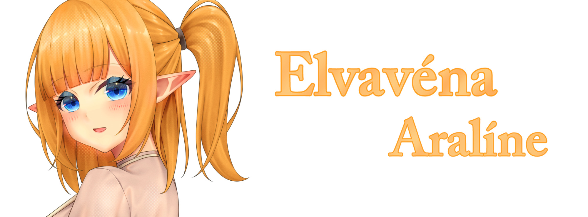
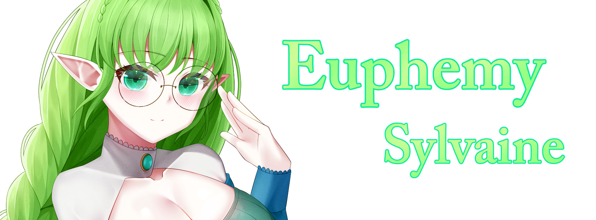
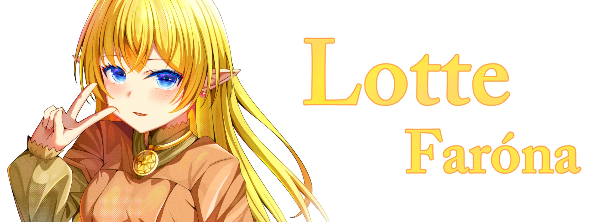
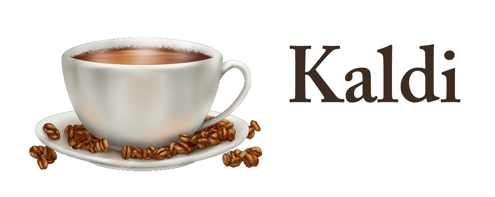

# MhLib







**All mascot art made by [Lori Hagami](https://www.deviantart.com/lorihagami)!**

--

**MhLib** is an experimental C++ library (hobby project) intended to have the following features:
- 3D rendering engine, abstracting around OpenGL 4.x (4.x, but with optional 4.6 things), OpenGL ES 3.2, Direct3D 11, Vulkan and Direct3D 12.
- Audio engine
- I/O abstractions
- Various convenient utility classes based off .NET and Qt

The documentation is a tree, not a pile of files. This page is the overview; `docs/`
holds the design reasoning and one page per module; the headers are the API reference.
A module page (`<Module>/README.md`) is the source of truth for **what exists and what
is still a TODO**, and every note under `docs/` says which kind of claim it makes
(contract, guide, study, status report or history).

## Documentation map

| Entry point | What it is |
|---|---|
| \subpage docs_index | The documentation tree: the design notes, the module pages and the rules they follow |
| [`docs/DOCUMENTATION.md`](docs/DOCUMENTATION.md) | The comment policy (Qt/Javadoc Doxygen), the note tree, and the checks that keep both honest |
| [`docs/modules/index.md`](docs/modules/index.md) | One page per module: status, implemented surface, TODOs |
| [`docs/graphics/index.md`](docs/graphics/index.md) | The Kaldi walkthrough and the shader pipeline |
| [`docs/text/index.md`](docs/text/index.md) | The MML specification and the CSS-for-MML study |
| [`docs/networking/index.md`](docs/networking/index.md) | The netcode foundation, the HTTP layer and the platform I/O seams |

Render the reference (headers plus every note) into the shadow build tree:

```sh
doxygen Doxyfile
$BROWSER build/doxygen/html/index.html
```

The output goes to `build/doxygen/`, never into the source tree. CI renders the same
site and publishes it in [`.github/workflows/doxygen.yml`](.github/workflows/doxygen.yml);
a Doxygen warning becomes an annotation on the run, because the default render is
expected to be warning-free ([`docs/DOCUMENTATION.md`](docs/DOCUMENTATION.md) §8).

## Repository layout

| Path | What it is |
|---|---|
| `Elvavena/` | The foundational utility library: device abstraction, containers/allocators, serialization, scope guards, event loop, networking protocol foundation |
| `Euphemy/` | The media and platform layer: concrete devices and sockets, image/audio codecs, compression and crypto proxies, configuration, optional PMR arenas, CPU asset runtime |
| `Haruka/` | The pull-based audio graph: mixers, panners, resamplers, streamers, effect chain |
| `Kaldi/` | The graphics HAL/RHI: the command vocabulary, HAL 1.0–1.2, the recording facade, the backend C ABI |
| `KaldiGL/`, `KaldiGLES/`, `KaldiVK/` | The OpenGL, OpenGL ES and Vulkan backends (complete executors) |
| `KaldiGLCommon/`, `KaldiD3DCommon/` | Shared sources compiled into the GL family and the D3D family (no library) |
| `KaldiD3D11/`, `KaldiD3D12/` | The Direct3D backends: device ownership and capability probes; no command executor yet |
| `Lotte/` | The graphics/GUI layer above Kaldi: shader compilation, GPU asset streaming, font/vector formats, rich text, geometry batches, GUI base |
| `UnitTests/` | The Catch2 suite — the automated gate, including the documentation-tree checks |
| `Sandbox/` | The manual playground; hardcoded paths and experiments are allowed here and it gates nothing |
| `docs/` | The note tree (`docs/index.md` is its root) |
| `extern/` | Submodules (doxygen-awesome-css theme, DirectX-Headers, …); never documented by this project. `extern/netsurf/` holds the CSS engine (libcss + libparserutils + libwapcaplet) and is built by its own buildsystem into `build/`, so the engine is the pinned checkout rather than the host copy |
| `build/` | Shadow build output — **every** generated artefact goes here, never into the source tree |

## Module status

This is the short version; each module's page has the detailed "implemented vs TODO"
list, and the headers are the API reference.

| Module | Status | What works today | Main remaining work |
|---|---|---|---|
| [Elvavena](Elvavena/README.md) | Implemented, networking M4 + M5 reference pipeline, minimal HTTP core, platform I/O seam | Device abstraction, containers/allocators, `DataStream`/schema with checked LEB128, bit-level packet codec, transport-agnostic session with reliable channels/fragmentation/heartbeats, deterministic loopback, clock sync, typed RPC, NetId/component schema/entity registry/interest hooks, snapshot/delta baselines, field-level deltas, interpolation/jitter, prediction/rollback and lockstep helpers, reference replication pipeline, HTTP parser/serializer, checksums/ring buffers, portable `EventPoller`/`EventLoopWakeup` seams, `EventLoop` and `PollingEventLoop`, contiguous streaming ring buffer, scope guards/defer stack, async I/O, thread pool, dynamic libraries, signals/slots | WinSock/IPv6 coverage, `select(2)` fallback, HTTP TLS/chunked/keep-alive, per-handle timers/poll cancellation |
| [Euphemy](Euphemy/README.md) | Implemented, small gaps | File/memory/socket/temp devices, UDP `DatagramTransport` over `EuphSocket`, minimal HTTP client/server over TCP/UDP, epoll/kqueue/WSAPoll pollers, eventfd/pipe/socket-pair wakeups, optional io_uring and IOCP completion wrappers (accept/connect/fixed buffers), zstd + crypto proxies, PNG/JPEG/TGA/WebP encode+decode, GIF/DDS decode, sound files, module rendering, resampling, convolution, config, optional PMR arenas, CPU asset runtime | `BufferDevice::isValid()` stub; GIF/DDS encoders; WinSock/IPv6/kqueue CI; `select(2)` fallback; `sendmsg` buffer rings |
| [Haruka](Haruka/README.md) | Partial | Pull-based `Playable` graph, mixer, matrix/ambisonic panners, resampler, sound/module streamers (using Elvavena's `ContiguousRingBuffer`), in-memory sources, dry/wet effect chain (clamp, crush, convolver, impulse-response synthesis) | No output device, no listener/3D model, wider test coverage |
| [Kaldi](Kaldi/README.md) | Contract + facade implemented | HAL 1.0/1.1/1.2 contract, 98-opcode command vocabulary, header-only recording facade, merge/deferred-destroy helpers, `KldNativeWindow.hpp` (SDL → native handles) and `KldConfig.hpp` (backend configuration contract) | Swapchain/render-pass RAII proxies; tests for the facade; a portable capability fallback |
| [KaldiGL](KaldiGL/README.md), [KaldiGLES](KaldiGLES/README.md), [KaldiVK](KaldiVK/README.md), [KaldiD3D11](KaldiD3D11/README.md), [KaldiD3D12](KaldiD3D12/README.md) | GL/GLES: working; Vulkan: working, HAL 1.2; D3D11/D3D12: stubs | Shared library target and C ABI exports; real context/device creation (GL/GLES: EGL or GLX, WGL on Windows; Vulkan: instance/surface/device/queues; D3D11/D3D12: device + swap chain, unverified); format/vertex-input/sampler translation tables (`KaldiGLCommon/GlUtil`, `KaldiVK/VkUtil`, `KaldiD3DCommon/D3DUtil`); SPIR-V → GLSL/HLSL cross-compilation; complete GL/GLES and Vulkan `processCommandQueue` implementations (GL names retired by the driver, Vulkan with three frames in flight, fence-driven retirement and a descriptor ring); explicit swapchain objects on GL/GLES and Vulkan; Vulkan debug labels via `VK_EXT_debug_utils` | Direct3D 11/12 command translation; Vulkan depth/stencil readback; verification of the Windows-only halves |
| [KaldiGLCommon](KaldiGLCommon/README.md), [KaldiD3DCommon](KaldiD3DCommon/README.md) | Shared sources (no library) | GL/GLES and D3D11/D3D12 common helpers: context layer (`Context`, `ContextConfig`, EGL/GLX), format tables, texture uploads, vertex layouts, SPIR-V cross-compilers, chained through a `.pri` | Nothing pending; grows with each backend |
| [Lotte](Lotte/README.md) | Partial | Kaldi facade aliases, HLSL/GLSL → SPIR-V shader compilation (glslang's HLSL front-end — deprecated upstream, see [`docs/graphics/SHADERS.md`](docs/graphics/SHADERS.md) — owning `ShaderBinary` + `Kld::ShaderBinaryDescriptor` views), CPU→GPU asset streamer, FontPacker font (`WODF` versions 1-3) and vector-image (`WODI`) formats, MML parser, rich-text runs, text layout with the SDF padding runway, lazy multi-page SDF glyph atlases, a family/style font repository, an SDF/MSDF/MSDFA text renderer with per-vertex colour and weight-derived threshold offsets, glyph quads, mesh and GUI geometry batches, a GUI render-tree/widget base with per-state textured widgets, and an abstract theme/nine-slice contract | Renderer, concrete GUI controls/layout/input, 3D |
| [UnitTests](UnitTests/README.md) | Working | Catch2 suite: asset runtime behaviour, zstd/Snappy round-trips, PNG/TGA round-trips, font `WODF`/`WODI` round-trips, configuration round-trip, shader compilation, Vulkan/DXGI format tables, SDL window-handle extraction, backend config clamping, bit-stream/loopback/session netcode, clock/RPC/replication core, snapshot delta baselines and field deltas, interpolation/jitter, prediction/rollback, lockstep, reference pipeline, HTTP parser/TCP/UDP client-server, ring-buffer/event-loop/event-poller/io_uring paths, localhost UDP, and the `[docs]` note-tree checks | More codec and Kaldi backend coverage; WinSock/IPv6/kqueue paths |
| [Sandbox](Sandbox/README.md) | Manual playground | Ad-hoc scenarios: GPU asset streamer, async I/O, image dumps, audio effects, text pipeline, signals, geometry batches, netcode loopback replication | Grows as needed by hand; not part of the gate |


## Building

This is a qmake project. Makefiles are generated artifacts; keep every build product
inside `build/`.

```sh
cd build/Desktop-Debug
/usr/bin/qmake6 ../../Project.pro
env MAKE=/usr/bin/make /usr/bin/make -j16 QMAKE=/usr/bin/qmake6
LD_LIBRARY_PATH=Elvavena:Euphemy:Lotte:Haruka:KaldiVK ./UnitTests/UnitTests
LD_LIBRARY_PATH=Elvavena:Euphemy:Lotte:Haruka ./Sandbox/Sandbox
```

The sibling shared libraries are not found through an rpath, so the `LD_LIBRARY_PATH`
prefix is required when running the test binaries from the shadow build tree.
`UnitTests` also carries `KaldiVK`, because it links the Vulkan backend's translation
layer (`VkUtil`) without creating a device.
`UnitTests` exits non-zero on a failed check; `Sandbox` is a manual playground and is
expected to be edited and run by hand.

Use the absolute `make`/`qmake6` paths: a terminal may rewrite `argv[0]`, and GNU make
then derives a wrong `MAKE` variable and spawns new IDE windows instead of recursive
builds. See `AGENTS.md` for the full rule.

## Testing

```sh
cd build/Desktop-Debug
LD_LIBRARY_PATH=Elvavena:Euphemy:Lotte:Haruka:KaldiVK ./UnitTests/UnitTests            # everything
LD_LIBRARY_PATH=Elvavena:Euphemy:Lotte:Haruka:KaldiVK ./UnitTests/UnitTests "[net]"    # one tag
LD_LIBRARY_PATH=Elvavena:Euphemy:Lotte:Haruka:KaldiVK ./UnitTests/UnitTests "[docs]"   # the note tree
```

The suite and its tags are described in [`UnitTests/README.md`](UnitTests/README.md).
The `[docs]` tag is the documentation gate: it checks that every note declares a page
id and is listed in its folder index, that every `\subpage` row resolves, that every
module README is a page listed in [`docs/modules/index.md`](docs/modules/index.md), and
that `## References` is the last section of every note
([`docs/DOCUMENTATION.md`](docs/DOCUMENTATION.md) §11).

## Long-term plans

- Developing Haruka
- Development of the various Kaldi backends
- More development on everything, until we have the foundations for a 3D engine (Lotte)
- Eventual conversion from QMake to CMake (QMake is convenient for usage in QtCreator and other IDEs, making the addition of new files trivial for human developers)
- Eventual integration of [WasmJIT](https://github.com/Metalhead33-Foundation/Wasmjit/tree/master) into this project, to make it a first-class citizen of MhLib.

The project is intended as a spiritual successor of the original 1998 Unreal Engine and 1999 Quake 3 engine, albeit using modern graphics APIs (strictly programmable shaders, no fixed-function or immediate-mode hijinks), surrounded by a utility library loosely inspired by .NET and Qt. The Unreal Engine aspect is mainly manifested in the "rendering backends are dynamic linking libraries loaded at runtime, implementing an abstract interface: the engine itself is strictly backend-agnostic" philosophy, while the Quake 3 engine aspect is manifested in the long-term goal of integrating a spiritual successor of QVM: [WasmJIT](https://github.com/Metalhead33-Foundation/Wasmjit/), a WebAssembly engine that has Euphemy and Elvavena as its dependencies.

